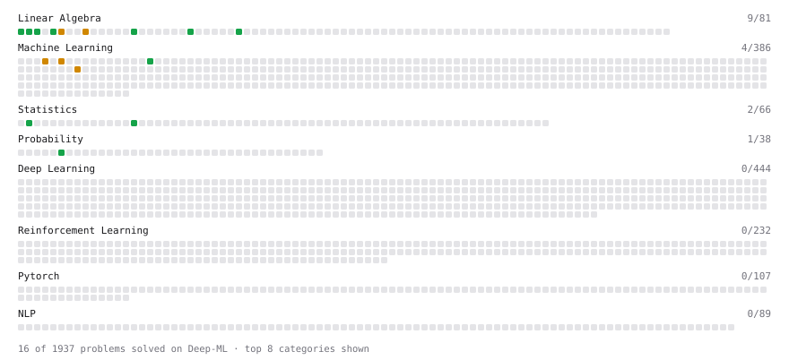

# Deep-ML

My machine learning practice from [Deep-ML](https://www.deep-ml.com). Every solution here was written by hand.

**14** solved · 12 problems · 2 labs · 0 math

[**Browse the interactive portfolio**](https://morettitommaso.github.io/deep-ml/) to replay this filling in over time.

## Problems

| | Difficulty | Solved | |
| --- | --- | --- | --- |
| [Calculate Conditional Probability from Data](https://www.deep-ml.com/problems/168) | easy | 2026-07-13 | [solution](problems/0168-calculate-conditional-probability-from-data) |
| [Convert Vector to Diagonal Matrix](https://www.deep-ml.com/problems/35) | easy | 2026-02-18 | [solution](problems/0035-convert-vector-to-diagonal-matrix) |
| [Descriptive Statistics Calculator](https://www.deep-ml.com/problems/78) | easy | 2026-07-13 | [solution](problems/0078-descriptive-statistics-calculator) |
| [Dot Product Calculator](https://www.deep-ml.com/problems/83) | easy | 2026-02-18 | [solution](problems/0083-dot-product-calculator) |
| [Generate Normal Samples and Compute Histogram Counts](https://www.deep-ml.com/problems/1130) | easy | 2026-07-13 | [solution](problems/1130-generate-normal-samples-and-compute-histogram-counts) |
| [Implement Compressed Row Sparse Matrix (CSR) Format Conversion](https://www.deep-ml.com/problems/65) | easy | 2026-02-18 | [solution](problems/0065-implement-compressed-row-sparse-matrix-csr-format-conversion) |
| [Matrix-Vector Dot Product](https://www.deep-ml.com/problems/1) | easy | 2026-02-18 | [solution](problems/0001-matrix-vector-dot-product) |
| [Reshape Matrix](https://www.deep-ml.com/problems/3) | easy | 2026-02-18 | [solution](problems/0003-reshape-matrix) |
| [Scalar Multiplication of a Matrix](https://www.deep-ml.com/problems/5) | easy | 2026-02-18 | [solution](problems/0005-scalar-multiplication-of-a-matrix) |
| [Transpose of a Matrix](https://www.deep-ml.com/problems/2) | easy | 2026-02-18 | [solution](problems/0002-transpose-of-a-matrix) |
| [Calculate Eigenvalues of a Matrix](https://www.deep-ml.com/problems/6) | medium | 2026-02-23 | [solution](problems/0006-calculate-eigenvalues-of-a-matrix) |
| [Matrix times Matrix ](https://www.deep-ml.com/problems/9) | medium | 2026-02-19 | [solution](problems/0009-matrix-times-matrix) |

## Labs

| | Difficulty | Solved | |
| --- | --- | --- | --- |
| [Design Your Own Activation Function](https://www.deep-ml.com/labs/9) | easy | 2026-02-23 | [solution](labs/0009-design-your-own-activation-function) |
| [Train a Linear Regression Model](https://www.deep-ml.com/labs/18) | easy | 2026-02-24 | [solution](labs/0018-train-a-linear-regression-model) |

---

_This file is regenerated by Deep-ML on every push._
